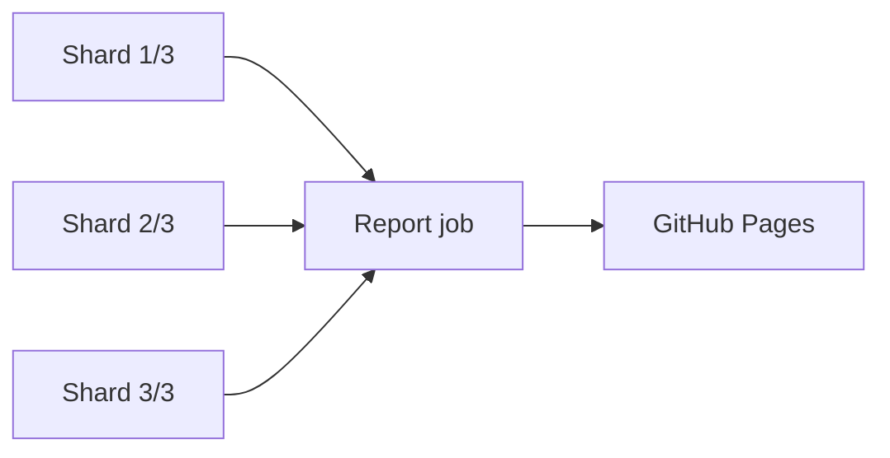

# Pulse Fitness — Join the Club

A one-page Vite + React signup app and its Playwright E2E suite (TypeScript, Page Object Model).

The app has no backend: the submit is a simulated 1.2 s delay and the pass code is generated in the browser. A reload resets everything.

**Latest CI report:** https://alexzavg.github.io/test_task_yet_another_demo/

## Contents

- [Run the app locally](#run-the-app-locally)
- [Playwright suite](#playwright-suite)
- [CI/CD](#cicd)

## Run the app locally

Requires Node.js 24.

```bash
npm i
npm run dev     # start the app
npm start       # start the app and open it in the browser
```

The app opens at http://localhost:5173. If the port is busy, Vite picks another one and prints it.

## Playwright suite

### Run tests

```bash
npx playwright install chromium   # first run only
npm test                          # all tests, starts the dev server itself
npm test -- --grep @smoke         # by tag: @smoke, @regression, @signup
npm run test:ui                   # UI mode
npm run test:report               # open the last report
```

### Structure

```
tests/signup/        specs
pages/               page objects (actions and assertions)
locators/            locators, one class per page
data/                test data and types
utils/               fixtures, pageManager, @step decorator, data generator, tags
documentation/       test cases, bug reports, risk assessment
```

### How it fits together

- **Specs** import only `test`/`step` from `utils/fixtures`, `tags` and their data module. They hold no `expect` and no locators.
- **`pageManager` fixture** is the single entry point to every page object and helper: `pageManager.signupPage`, `pageManager.dataGenerator`.
- **Page objects** extend `PageActions` and own both actions and assertions. Every method has a `@step` decorator, so it shows as a named step in the report, trace and UI mode.
- **Locators** prefer roles and labels (the app has no `data-testid`) and end with `.describe()` for readable traces.
- **Test data** is unique per test: `dataGenerator.generateMember()` creates a new member each time, so tests run safely in parallel.
- **`annotations` fixture** records what a test produced (email, pass code) in the report and the trace, also when the test fails.

A spec reads as a sequence of business steps (shortened from `tests/signup/confirmation-card.spec.ts`):

```ts
test(
  'A signup without any goal shows a dash as the goals summary value',
  { tag: [tags.REGRESSION, tags.SIGNUP] },
  async ({ pageManager, annotations }) => {
    const member = pageManager.dataGenerator.generateMember()
    annotations['email'] = member.email

    await step('Fill in the member details', async () => {
      await pageManager.signupPage.fillMemberDetails(member, homeClubs.harborPoint)
    })
    await step('Submit the form', async () => {
      await pageManager.signupPage.submit()
    })
    await step('Verify the confirmation card', async () => {
      await pageManager.signupPage.verifyConfirmationShownFor(member.firstName)
    })
  },
)
```

The page object behind it:

```ts
@step('Verify the confirmation card is shown for {firstName}')
async verifyConfirmationShownFor(firstName: string): Promise<void> {
  await expect(this.locators.confirmationHeading).toContainText(firstName)
}
```

### Configuration

`playwright.config.ts` reads `BASE_URL` from `.env.<test_env>` (`.env.local` by default). One project: Desktop Chrome. Screenshots, video and trace are kept on failure only.

|          | Local               | CI                                        |
| -------- | ------------------- | ----------------------------------------- |
| Workers  | 1                   | 4 per shard                               |
| Retries  | 0                   | 1                                         |
| Server   | `npm run dev`       | `npm run preview` of the production build |
| Reporter | list + smart report | list + blob (merged later)                |

### Reports

`playwright-smart-reporter` writes `smart-report/index.html`, with run history in `smart-report/test-history.json`.

The reporter also uses AI to summarize failures. This runs only when an AI provider key is set, for example `ANTHROPIC_API_KEY`, `OPENAI_API_KEY` or `GEMINI_API_KEY`. Without a key, the report is built without the AI summary.

## CI/CD

Workflow: `.github/workflows/playwright.yml` (GitHub Actions).

**Triggers:** every push (except to `gh-pages`) runs `@regression`. A manual run lets you pick `@smoke`, `@regression` or `@signup`. A weekday 09:00 schedule is defined but paused. A new push to the same branch cancels the run in progress.

**Flow**, following the YAML from the start:

1. 3 test jobs start at the same time, one per shard. Each runs on its own fresh VM, with no setup job before them.
2. Each shard prepares its VM:
   - checkout and setup-node;
   - restore the `node_modules` cache and the browsers cache;
   - skip the install and save steps when the cache hits;
   - `npm run build`.
3. Each shard runs its slice of tests (`--shard=N/3`, 4 workers) and uploads its `blob-report-N` artifact, also when tests fail.
4. The report job starts once all 3 shards have finished. It runs even if some shards failed. It restores the `node_modules` cache, pulls `test-history.json` from `gh-pages`, downloads the 3 blob reports, merges them into one smart report and publishes it to GitHub Pages.



The run summary links to the published report. Every branch publishes to the same site, so the latest run wins.
