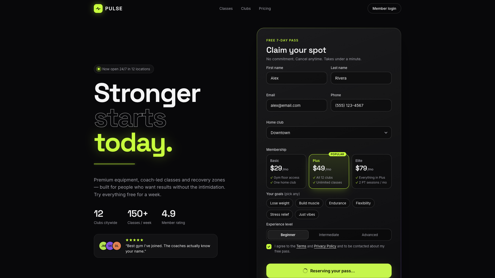

# BUG-001: "Loading state on 'Get my free pass' lasts 1.2 s instead of the required 1.8 s"

**Severity:** S3 - Minor

**Priority:** P2 - Medium

## Summary

The loading state after clicking `Get my free pass` lasts about 1.2 s instead of the required 1.8 s.

## Environment

- **URL:** http://localhost:5173/
- **Device:** Desktop Chrome 1920x1080
- **OS Version:** macOS 15.4.1 (24E263)
- **Browser:** Chrome 155.0.8059.85 (headless, driven by the Playwright CLI)
- **User Agent:** Mozilla/5.0 (Macintosh; Intel Mac OS X 10_15_7) AppleWebKit/537.36 (KHTML, like Gecko) HeadlessChrome/155.0.0.0 Safari/537.36

## Preconditions

The signup page is open at http://localhost:5173/ in desktop Chrome.

## Test Data

- First name: `Alex`
- Last name: `Rivera`
- Email: `alex@email.com`
- Phone: typed as `5551234567` (displays `(555) 123-4567`)
- Home club: `Downtown`
- Membership plan: `Plus` (default)
- Experience level: `Beginner` (default)
- Goals: none selected
- Consent checkbox: checked

## Steps to Reproduce

1. Fill the First name, Last name, Email, Phone and Home club fields with the test data.
2. Check the consent checkbox.
3. Click the `Get my free pass` button.
4. Measure how long `Reserving your pass…` stays on the button before the confirmation card appears (for example with a screen recording or the browser Performance panel).

## Actual Result

The button shows the spinner and `Reserving your pass…` for about 1.2 s, then the confirmation card replaces the form.

## Expected Result

The button stays disabled with the spinner and `Reserving your pass…` for 1.8 s, then the confirmation card replaces the form.

## Media Files

**Desktop — button in the loading state (disabled, spinner, `Reserving your pass…`):**

**Desktop — full flow recorded with action annotations (loading state visible for about 1.2 s):**

<video controls width="720">
  <source src="artifacts/bug-001-repro.webm" type="video/webm">
</video>

## Additional Info

- **Requirement:** Jira QAA-1, R19 and AC12, with Figma frames 07-v3-state-sheet ("Primary · loading (1.8s)") and 05-desktop-v3-loading. On a valid submit the button is disabled and shows a spinner with `Reserving your pass…` for 1.8 s, then the confirmation card replaces the form card.
- **What works:** the button becomes disabled, the spinner and `Reserving your pass…` appear, and the arrow icon is hidden. Only the duration is wrong.
- **Measurement:** a MutationObserver ran from the moment the button text changed to `Reserving your pass…` until the `.card.success` confirmation card was inserted. Three consecutive submits gave 1202 ms, 1201 ms and 1202 ms (click to card: 1205, 1204 and 1205 ms).
- **Root-cause pointer:** `src/App.jsx` around lines 113-116 calls `setTimeout(..., 1200)` for the simulated submission.
- **Console:** 0 errors, 0 warnings.
- **Severity rationale:** the signup still completes and no wrong data is shown, but the specified loading duration is not met. That duration supports the product decision on visible loading feedback and double-submit protection.
