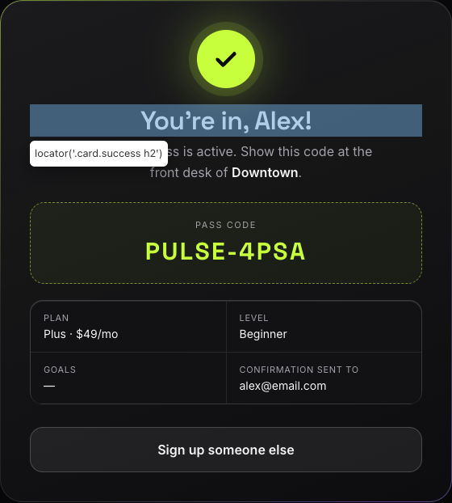

# BUG-002: "Confirmation heading uses a straight apostrophe instead of the typographic apostrophe U+2019"

**Severity:** S4 - Low

**Priority:** P3 - Low

## Summary

The confirmation card heading uses a straight apostrophe (U+0027) instead of the typographic apostrophe (U+2019).

## Environment

- **URL:** http://localhost:5173/
- **Device:** Desktop Chrome 1920x1080
- **OS Version:** macOS 15.4.1 (24E263)
- **Browser:** Chrome 155.0.8059.85 (headless, driven by the Playwright CLI)
- **User Agent:** Mozilla/5.0 (Macintosh; Intel Mac OS X 10_15_7) AppleWebKit/537.36 (KHTML, like Gecko) HeadlessChrome/155.0.0.0 Safari/537.36

## Preconditions

The signup page is open at http://localhost:5173/ in desktop Chrome.

## Test Data

- First name: `Alex`
- Last name: `Rivera`
- Email: `alex@email.com`
- Phone: `5551234567`
- Home club: `Downtown`
- Membership plan: `Plus` (default)
- Experience level: `Beginner` (default)
- Goals (optional for this defect): `Build muscle`, then `Stress relief`

## Steps to Reproduce

1. Enter `Alex` in the First name field and `Rivera` in the Last name field.
2. Enter `alex@email.com` in the Email field and type `5551234567` in the Phone field.
3. Select `Downtown` as the Home club.
4. Optionally select the goals `Build muscle` and `Stress relief`.
5. Check the consent checkbox.
6. Click the "Get my free pass" button and wait for the confirmation card.
7. In DevTools, run `[...document.querySelector('.card.success h2').textContent].map(c => c.charCodeAt(0).toString(16))`, or copy the heading text into a Unicode inspector.
8. Check the fourth character of the heading.

## Actual Result

The heading reads `You're in, Alex!` with a straight apostrophe (U+0027). The same happens for every first name.

## Expected Result

The heading reads `You’re in, {First name}!` with a typographic apostrophe (U+2019).

## Media Files

**Confirmation card showing the heading:**

**Full flow recorded, ending with the heading highlighted:**

<video controls width="720">
  <source src="artifacts/bug-002-repro.webm" type="video/webm">
</video>

## Additional Info

- The requirement is Jira QAA-1 R20 / AC13, and Figma frame 06-desktop-v3-success shows the typographic apostrophe.
- The first characters of the heading are U+0059, U+006F, U+0075, U+0027, U+0072, U+0065, so the apostrophe is U+0027 (APOSTROPHE), not U+2019 (RIGHT SINGLE QUOTATION MARK).
- The font renders the straight apostrophe slanted, so the defect is easy to miss on screen. The text content (copied text, screen-reader output, automated copy checks) differs from the approved copy.
- Root-cause pointer: `src/App.jsx` line 285 is `<h2>You're in, {data.firstName}!</h2>`.
- Impact: purely typographic, with no functional or data impact. The console shows 0 errors.
