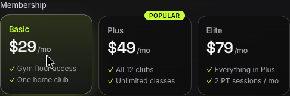
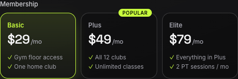

# BUG-003: "Selected membership plan card loses its lime border while the pointer is over it"

**Severity:** S4 - Low

**Priority:** P3 - Low

## Summary

A selected plan card shows the grey hover border instead of the lime selected border while the pointer is over it.

## Environment

- **URL:** http://localhost:5173/
- **Device:** Desktop Chrome 1920x1080
- **OS Version:** macOS 15.4.1 (24E263)
- **Browser:** Chrome 155.0.8059.85 (headless, driven by the Playwright CLI)
- **User Agent:** Mozilla/5.0 (Macintosh; Intel Mac OS X 10_15_7) AppleWebKit/537.36 (KHTML, like Gecko) HeadlessChrome/155.0.0.0 Safari/537.36

## Preconditions

The signup page is freshly loaded at http://localhost:5173/ in desktop Chrome, and the Plus plan card is selected (the default).

## Steps to Reproduce

1. Click the Basic plan card and keep the mouse pointer resting on it.
2. Observe the Basic card's border.
3. Move the pointer off the card and observe the border again.

## Actual Result

While the pointer is on the selected Basic card, its border is grey rgba(255, 255, 255, 0.3). It turns lime only after the pointer leaves.

## Expected Result

A selected plan card keeps its lime border (rgb(200, 255, 61)) while the pointer is over it, as in the Selected card state.

## Media Files

**Desktop — Basic selected, pointer still on the card (grey border):**

**Desktop — Basic selected, pointer moved away (lime border):**

**Desktop — click, hover and pointer leaving, recorded with action annotations:**

<video controls width="720">
  <source src="artifacts/bug-003-repro.webm" type="video/webm">
</video>

## Additional Info

- The plan itself is still selected: the radio is checked, the class is `plan plan--active`, the plan name is lime rgb(200, 255, 61), and the card lifts 2px.
- The same happens for any selected card the pointer hovers, including the default Plus card.
- Root cause: in `src/App.css`, `.plan:hover { border-color: rgba(255,255,255,0.3) }` (around line 566) has specificity 0,2,0 and overrides `.plan--active { border-color: var(--accent) }` (around line 575, specificity 0,1,0).
- The requirement is Jira QAA-1 AC4 / R10 and R24 / AC21: the clicked card becomes the only selected card, with a lime border and a lime plan name. The Figma state sheet (frame 07-v3-state-sheet) shows a lime border for the Selected card state and draws the Hover state for an unselected card only.
- Console: 0 errors.
